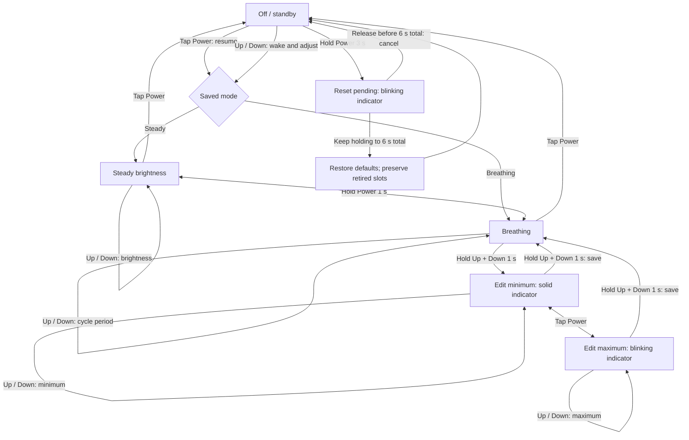

# PIC12F683 QY-K4 LED controller

Replacement C firmware for the PIC12F683-based QY-K4 LED controller, providing
steady dimming, adjustable breathing, and persistent settings. The controller
and indicator-only bench images build with MPLAB XC8; portable C tests exercise
the production button, dimmer, and EEPROM code on a PC.

The current controller image has been programmed and read back successfully.
Physical board acceptance and waveform measurements remain pending; see the
[validation record](docs/validation.md) and [bench checklist](docs/bench-checklist.md).

## Project structure

All paths below are relative to the repository root. A fresh checkout contains
source, scripts, tests, and documentation. Tools and generated artifacts are
local to your machine and excluded by [.gitignore](.gitignore).

```text
pic12-led-driver-firmware/
|-- firmware/       PIC firmware, board pin/polarity settings, and storage logic
|-- scripts/        PowerShell build, test, HEX verification, and flashing commands
|-- tests/          Host C suites, fake PIC registers, linked-image and script tests
|-- docs/           Technical design, validation records, and programming notes
|-- LICENSE         MIT license
|-- .tools/         Local compiler/SDK/dependency downloads (ignored; prepare first)
|-- minipro/        External MiniPro source checkout (ignored; prepare first)
|-- build/          Generated images, maps, test executables, and caches (ignored)
`-- backups/        Per-programming-run chip backups and logs (ignored)
```

The root also contains the [implementation plan](PIC12F683_LED_Controller_Firmware_Implementation_Plan.md)
and [board reconstruction notes](QY-K4_reconstruction_notes.md).

| Local path | What belongs here / when it appears |
| --- | --- |
| `.tools/xc8-v4.00/bin/xc8-cc.exe` | XC8 compiler; extract or install before building. |
| `.tools/pic-device-pack/xc8/` | Extracted PIC10-12Fxxx device-pack support files. |
| `.tools/zig-x86_64-windows-0.15.2/zig.exe` | Portable C compiler for host tests and the MiniPro build. |
| `.tools/zlib-1.3.2/` | Extracted zlib sources used when building MiniPro. |
| `.tools/tl866-driver/` | Optional location for USB driver downloads/extraction and installation logs. |
| `minipro/` | Clone of the upstream programmer tool, including its own Git metadata. |
| `build/` | Created by test/build scripts; contains `led-controller.hex`, `indicator-only.hex`, matching `.elf`/`.map` files, and host test executables. |
| `build/minipro/` | Created by the MiniPro build; contains `minipro.exe`, `infoic.xml`, `logicic.xml`, generated version header, and dependency licenses. |
| `build/zig-global-cache/`, `build/zig-local-cache/` | Created when scripts compile with Zig. Keep temporary experiments and archived build outputs under `build/` too. |
| `backups/program-pic12f683-<UTC timestamp>-<id>/` | Created only by a real flashing run; original chip contents, programming inputs, hashes, and logs. Keep these backups. |

Build scripts do not download tools or clone dependencies. Prepare `.tools/` and
`minipro/` first using the runbook below. A normal build creates `build/` but does
not create programming backups or access the programmer. `-WhatIf` also creates
no backups and makes no USB calls.

## User guide

The three buttons are **Power**, **Up**, and **Down**. A Power tap is a press and
release before one second; Up/Down taps are released before their 400 ms hold
threshold. Actions occur after button debounce, so the durations below are
approximate. A hold performs its action without requiring a release; releasing
after a hold adds no tap action.

With erased or unsupported EEPROM settings, the controller starts **off**, in
steady mode, with **50%** brightness, a **3-second** breathing cycle, and **10–100%**
breathing limits. Otherwise it restores the saved output state and preferences.

### Button reference

| State / mode | Button gesture | Result |
| --- | --- | --- |
| Off / standby | Tap Power | Turn on in the saved steady or breathing mode. Breathing starts at its minimum. |
| Off / standby | Tap or hold Up / Down | Turn on and adjust the saved mode: brightness in steady mode, cycle period in breathing mode. Wakes even at a brightness limit. |
| On, outside the limit editor | Tap Power | Turn off, retaining the selected mode and settings. |
| On, steady or breathing | Hold Power for 1 second | Switch steady ↔ breathing once, keep output on, and flash the status LED for about 0.5 seconds. Release before another mode hold. Longer holds do not reset settings. |
| Steady | Tap Up / Down | Raise / lower brightness by 10 percentage points, within 10–100%, with an extra 0.25% level. Down from 10% or below selects 0.25%; Up from 0.25% selects 10%. |
| Steady | Hold Up / Down for 400 ms | Ramp by 1 percentage point about every 102 ms. Includes 1–9% and the 0.25% floor; holding Up from 0.25% starts at 1%. Down never turns the output off. |
| Breathing | Tap Up / Down | Lengthen / shorten the full rise-and-fall cycle by 0.5 seconds. Wraps between 0.5 and 10 seconds. |
| Breathing | Hold Up / Down for 400 ms | Repeat period changes about every 20 ms, including wraparound. |
| Breathing | Hold Up + Down together for 1 second | Pause breathing and enter the minimum-brightness editor. Release both buttons before another editor entry/exit gesture. |
| Minimum or maximum editor | Tap Up / Down | Adjust the selected limit by 10 percentage points, clamped to keep minimum below maximum. The main LEDs show a steady preview. See the low-level rules below. |
| Minimum or maximum editor | Hold Up / Down for 400 ms | Ramp the selected limit by 1 percentage point about every 102 ms, respecting the limits and the 0.25% minimum stop. |
| Minimum or maximum editor | Tap Power | Switch between editing minimum and maximum. |
| Minimum or maximum editor | Hold Power | No action; normal on/off and mode switching resume after leaving the editor. |
| Minimum or maximum editor | Hold Up + Down together for 1 second | Save both limits together and resume breathing from the minimum. |
| Off / standby | Hold Power continuously for 3 seconds | Arm settings reset; the status LED starts blinking. Keep holding to confirm. |
| Reset hold started while off | Release Power before 6 seconds total, after the tap threshold | Cancel reset; remain off with settings unchanged. |
| Reset hold started while off | Keep holding Power for 6 seconds total | Restore the defaults above and remain off. Preserve the EEPROM retired-slot map; continued holding does not repeat the reset. |
| Any mode | Overlap Power with Up / Down | Power takes priority and cancels the brightness/period gesture until both Up and Down are released. |
| Outside the editor entry/exit gesture | Press Up + Down together | Cancel individual adjustments until both buttons are released. In steady mode or standby, this does not open the editor. |

### Control flow

Up and Down change brightness in steady mode, cycle period in breathing mode,
and the selected brightness limit in the editor. Reset is available only when
the Power hold **starts while off**; a dark breathing frame still counts as on.



### Breathing limits and saved settings

Enter the limit editor while breathing, adjust minimum, tap Power to select
maximum, then hold Up + Down again to save and exit. Minimum can be off (0%),
0.25%, or a whole percentage below maximum; maximum is 1–100%. Down reaches
0.25% before off. **Holding Down stops at 0.25%**: release it and give a separate
Down tap to select off. Up from off selects 0.25% first; another tap selects 10%
subject to maximum, while a continued hold ramps through 1%, 2%, and so on.

Entering breathing starts near the saved steady brightness, clamped to its
limits; exiting restores steady brightness. Its brightness rises and falls
smoothly with an exponential envelope, with no explicit pauses at the endpoints.
Period changes leave steady brightness and breathing limits intact.

Brightness and period changes save after about 900 ms of inactivity. Power,
mode, editor confirmation, and reset request an immediate asynchronous save.
Allow the save to finish before disconnecting power; the last committed settings
are restored if power is lost during a save. Unconfirmed limit edits are lost on
power failure, and unchanged settings or animation alone do not write EEPROM.
See [EEPROM journaling](docs/eeprom-journal.md) for format and recovery details.

| Status LED | Meaning |
| --- | --- |
| Off | Normal operation or standby. |
| On for about 0.5 seconds | Switched between steady and breathing. Turning the output off cancels the flash. |
| Solid | Editing the breathing minimum. |
| Blinking about 250 ms on / 250 ms off | Editing the breathing maximum. |
| Blinking about 500 ms on / 500 ms off | Reset armed; release to cancel or continue holding to six seconds total. |
| Rapid blinking, about 131 ms on / 131 ms off | EEPROM slot retirement awaits a verified save. Overrides all other indications; if no safe destination remains, saves stop and the warning continues while controls work from RAM. |

## Build and flash runbook

Run these commands **one step at a time from the repository root in PowerShell
on Windows x64**. Stop if a command fails. The versions below are those used for
the [recorded validation](docs/validation.md#tool-provenance).

### 1. Prepare the tools

| Tool / hardware | Required for |
| --- | --- |
| PowerShell (tested with 7) and Git | Running the scripts and checking out MiniPro source. |
| [MPLAB XC8 v4.00](https://www.microchip.com/en-us/tools-resources/develop/mplab-xc-compilers/xc8) and [PIC10-12Fxxx_DFP 1.10.193](https://packs.download.microchip.com/Microchip.PIC10-12Fxxx_DFP.1.10.193.atpack) | Building PIC12F683 HEX images. The scripts use C99 and `-Os`. |
| Zig 0.15.2 | Building MiniPro with the supplied script; also supplies `zig cc` for host tests. GCC or Clang can run the host tests instead. |
| [zlib 1.3.2 sources](https://zlib.net/zlib-1.3.2.tar.gz) | Building MiniPro, linked directly into its executable. |
| [Node.js](https://nodejs.org/) | Running the linked HEX instruction-model checks. No npm packages are needed. |
| TL866CS or TL866A, working Windows USB driver, and appropriate socket/adapter | Flashing a socketed PIC12F683 and verifying readback. |

Create `.tools/` if needed:

```powershell
New-Item -ItemType Directory -Force .tools | Out-Null
```

Download and extract these inputs into the exact locations in the project
structure table. Keep the named top-level Zig/zlib directories; extract the
device pack's **contents** into `.tools/pic-device-pack/` so its `xc8/` folder is
directly beneath it. An `.atpack` is a ZIP archive. Put XC8's `bin/`, `pic/`, and
other extracted compiler directories directly under `.tools/xc8-v4.00/`.

- [XC8 v4.00 Windows x64 archive](https://ww1.microchip.com/downloads/aemDocuments/documents/DEV/ProductDocuments/SoftwareTools/xc8-v4.00-full-install-windows-x64.tar.xz)
- [PIC10-12Fxxx_DFP 1.10.193 archive](https://packs.download.microchip.com/Microchip.PIC10-12Fxxx_DFP.1.10.193.atpack)
- [Zig 0.15.2 Windows x64 ZIP](https://ziglang.org/download/0.15.2/zig-x86_64-windows-0.15.2.zip)
- [zlib 1.3.2 source archive](https://zlib.net/zlib-1.3.2.tar.gz)

These are setup inputs; they are not included in a Git clone of this project.
See [tool provenance](docs/validation.md#tool-provenance) and
[MiniPro build notes](docs/minipro-build.md) for recorded checksums and driver details.
Zig compiles C for the PC here; XC8 compiles the actual PIC firmware.

### 2. Build the programmer tool

For a fresh checkout, clone MiniPro into the ignored `minipro/` directory and
select the upstream revision used for validation. If that checkout already
exists, use it rather than cloning over it.

```powershell
git clone https://gitlab.com/DavidGriffith/minipro.git minipro
git -C minipro checkout 3e2f4911fa86f72a57ae0ace777342e75da5e7cc
.\scripts\build-minipro.ps1
```

Expected result: `build/minipro/minipro.exe`, both chip database files, and
licenses. Install the appropriate Windows driver, connect the TL866CS/A, then
check that MiniPro detects the programmer and recognizes the device profile:

```powershell
.\scripts\minipro.ps1 -V
.\scripts\minipro.ps1 -q tl866a -d PIC12F683
```

The first command should report the connected programmer; the second should
report PIC12F683 with 2,048 program words and 256 EEPROM bytes. Resolve USB driver
or database-path errors before flashing. [MiniPro setup details](docs/minipro-build.md)
cover the tested driver and build.

### 3. Run the host tests

```powershell
.\scripts\test.ps1
```

Expected result: all four C suites pass; executables appear in `build/`.
The script prefers the portable Zig path above, then searches for Clang, GCC,
and Zig. To use a different host compiler explicitly:

```powershell
.\scripts\test.ps1 -Compiler 'C:\path\to\gcc.exe'
```

### 4. Build and validate the PIC images

```powershell
.\scripts\build.ps1 -IndicatorOnly
.\scripts\build.ps1
node .\tests\test_hex.js
.\tests\test-program.ps1
```

Expected result: both builds and the linked-image/programming-script checks pass.
`build/indicator-only.hex` keeps the main GP2 output inactive and never accesses
EEPROM at runtime; `build/led-controller.hex` is the full controller. Matching
`.map`, `.elf`, and compiler reports stay under `build/`. The build automatically
checks HEX bounds/checksums, configuration `0x33C4`, and absence of EEPROM payload.
These commands do not flash a chip; the programming-script tests use a fake MiniPro.

If XC8 or the device pack is installed elsewhere, pass their locations (repeat
with `-IndicatorOnly` for the bench image):

```powershell
.\scripts\build.ps1 -Xc8 'C:\Program Files\Microchip\xc8\v4.00\bin\xc8-cc.exe' -DevicePack 'C:\path\to\PIC10-12Fxxx_DFP\1.10.193\xc8'
```

`-DevicePack` must name the pack's **xc8** folder. Review compiler memory usage;
the recorded controller build leaves only 35 flash words and 8 RAM bytes free.

### 5. Preview and flash the bench image

Check the [pin map and polarities](docs/hardware-layout.md), pin-1 orientation,
and programmer socket placement. Use the correct DIP8/SOIC8/DFN8 adapter and keep
the chip off the powered LED board. This runbook uses socket programming, not ICSP.

```powershell
.\scripts\program.ps1 -Firmware .\build\indicator-only.hex -WhatIf
```

Expected result: HEX and local tool/database paths validate and the planned
operation is printed, with no USB access or backup directory created. For a real
bench-image write:

```powershell
.\scripts\program.ps1 -Firmware .\build\indicator-only.hex
```

A real write first backs up and verifies the chip, then erases/replaces flash,
restores EEPROM and user IDs, writes configuration last, and verifies every
region. It creates a fresh `backups/program-pic12f683-<UTC timestamp>-<id>/` with
original contents, inputs, `program.log`, and `manifest.json`. Retain it. A failure
stops the sequence; inspect the log and manifest before retrying.

Complete the [indicator-only board checks](docs/bench-checklist.md) before the
full controller. Holding Power while off for three seconds shows the reset
warning; release before six seconds to cancel. GP2 should remain inactive.

### 6. Flash the controller and check operation

```powershell
.\scripts\program.ps1 -WhatIf
.\scripts\program.ps1
```

The default image is `build/led-controller.hex`. The default device profile is
`PIC12F683`; add `-Device 'PIC12F683@SOIC8'` or `-Device 'PIC12F683@DFN8'` when
appropriate for your package. This does not change physical adapter wiring.
Expect a completed verification message and `status: verified` in the manifest.
Then follow the [board acceptance checklist](docs/bench-checklist.md), including
PWM, button, breathing, persistence, and reset checks.

EEPROM and user IDs are preserved by default. Only v6 settings are understood by
the firmware; older bytes are backed up but are not migrated. To deliberately
erase preferences **and the retired-slot map** while programming, use:

```powershell
.\scripts\program.ps1 -ResetSettings
```

That option differs from the six-second button reset, which preserves retired
slots. See [programming and recovery details](docs/programming.md) for the exact
write order, alternative tool/backup paths, and failure handling.

## Technical documentation

| Topic | Reference |
| --- | --- |
| EEPROM format, atomic saves, retries, and recovery | [EEPROM journal](docs/eeprom-journal.md) and [bad-slot tracking](docs/bad-slot-tracking.md) |
| PWM frequency, duty resolution, and timing | [PWM and timing](docs/pwm-and-timing.md) |
| Exponential envelope, fractional dithering, editor, and reset | [Breathing behavior](docs/breathing.md) and [interactive curve comparison](docs/breathing-demo.html) |
| PIC pin map, polarities, configuration, and watchdog | [Hardware layout](docs/hardware-layout.md) |
| Test coverage and physical validation limits | [Coverage overview](docs/test-coverage.md) |
| Recorded builds, memory use, tool provenance, and programming runs | [Validation record](docs/validation.md) |
| Remaining physical acceptance checks | [Bench checklist](docs/bench-checklist.md) |
| MiniPro dependencies, Windows build, and USB driver | [MiniPro build notes](docs/minipro-build.md) |
| Backup, flashing, verification, and failure handling | [Programming notes](docs/programming.md) |

## License

[MIT](LICENSE).
